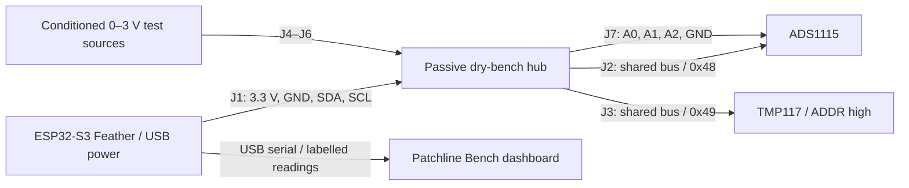

# Dry bench wiring — not a wearable medical board

Built by Rishik Rontala. This board is a passive interconnect for external development modules. Do not connect it to a person, wound, electrode, therapeutic emitter, or battery charger.

| Connector | Pin 1 | Pin 2 | Pin 3 | Pin 4 |
|---|---|---|---|---|
| J1 host | GND | 3.3 V | SDA | SCL |
| J2 ADS1115 bus | GND | 3.3 V | SDA | SCL |
| J3 TMP117 bus | GND | 3.3 V | SDA | SCL |
| J4 pH front-end signal | PH_SIG | GND | 3.3 V | — |
| J5 wetness front-end signal | MOIST_SIG | GND | 3.3 V | — |
| J6 glucose front-end signal | GLUCOSE_SIG | GND | 3.3 V | — |
| J7 ADS1115 analog inputs | A0 (PH_SIG) | A1 (MOIST_SIG) | A2 (GLUCOSE_SIG) | GND |

Pin 1 is the square pad. These custom header assignments do not match arbitrary commercial sensor headers; wire by signal name, never by plug appearance.

Choose an Adafruit ESP32-S3 Feather (product 5323), ADS1115 breakout (1085), TMP117 breakout (4821), seven 2.54 mm headers (four 1×4, three 1×3), jumpers and USB data cable. Modules remain external. No parts have been ordered. Breakout dimensions and connector positions must be reviewed before fabrication.

Configure TMP117 ADDR high / address 0x49 before attaching it. ADS1115 stays 0x48. Both default to 0x48, so leaving defaults causes an address collision. Feather I²C power must be enabled. Use module pullups to 3.3 V; do not add 5 V pullups. Check aggregate pullup strength and bus capacitance on the bench.

Start with all power disconnected. Inspect pad numbering and continuity against netlist.json. Verify no rail shorts. Use the Feather's USB-powered 3.3 V output for this small external-module prototype; do not back-feed another supply. Confirm grounds before connecting analog channels. Only use conditioned 0–3 V sources with a shared bench ground. The ADS1115 gain setting is not input overvoltage protection. The hub has no protection circuitry: review current limiting and conditioning before real signals.

pH electrodes require a suitable high-impedance interface, and electrochemical glucose sensors require a suitable potentiostat / analog front end. Neither can connect directly to these headers. For the first prototype use calibrated voltage sources or divider test fixtures. Moisture is a bench surrogate. Glucose remains arbitrary signal units; no blood or wound glucose conversion is supplied.

Required gates before fabrication/use: open the PCB in KiCad 8+, run DRC and inspect clearances, pads, mask, silkscreen and drill dimensions; review electrical wiring; measure continuity and rail voltage; compile and flash the firmware; verify I²C scan 0x48 and 0x49; compare each ADC channel against a meter; unplug sensors and confirm missing telemetry; review bench calibration with known references. None of these physical checks have been performed.

Software review has checked all seven nets across both copper layers, joining layers only through plated header pads. A separate geometric check includes track widths and conservatively treats every pad as a 1.8 mm square. The smallest resulting gap is 0.74 mm, above the chosen 0.25 mm software threshold. This is not KiCad DRC or approval for fabrication: footprint libraries, silkscreen, mask, drill tolerances, electrical protection and manufacturer constraints remain to be reviewed. Rebuilding the generator reproduces PCB, preview, netlist and proof byte for byte.

Both firmware modes compile for the exact Feather No PSRAM target. Native tests exercise failed/short bus reads, an ADC that never becomes ready, wrong temperature-device ID, invalid temperatures, signed readings, channel configuration, calibration refusal and both telemetry provenance modes. These checks use host stubs and have not measured a real sensor or bus timeout.

Sources: [Feather pinouts](https://learn.adafruit.com/adafruit-esp32-s3-feather/pinouts), [ADS1115 datasheet](https://www.ti.com/lit/ds/symlink/ads1115.pdf), [TMP117 address setup](https://learn.adafruit.com/adafruit-tmp117-high-accuracy-i2c-temperature-monitor/arduino).
